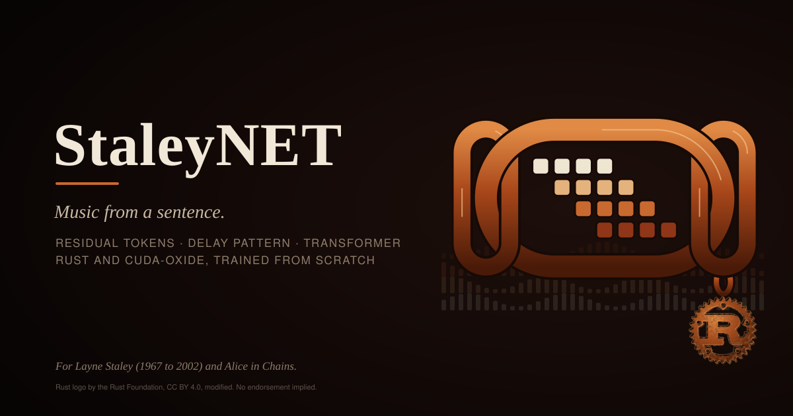
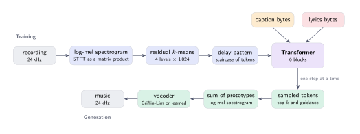
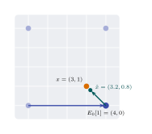
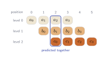
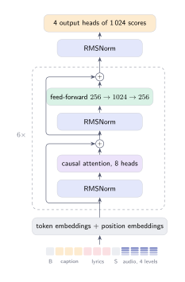
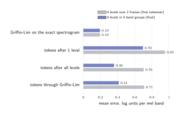

<p align="center">
  
</p>

<h1 align="center">StaleyNET</h1>

<p align="center">
  Text-prompted music generation with singing, built from first principles in Rust<br>
  and trained from scratch on two NVIDIA Jetson computers.
</p>

<p align="center">
  <a href="https://crates.io/crates/staleynet-audio"></a>&nbsp;
  <a href="LICENSE"></a>&nbsp;
  <a href="docs/assets/paper-preprint.pdf"></a>&nbsp;
  <a href="#book-and-paper"></a>&nbsp;
  <a href="https://huggingface.co/arpanpathak/staleynet-checkpoints"></a>&nbsp;
  <a href="https://huggingface.co/datasets/arpanpathak/staleynet-data"></a>
</p>

<p align="center">
  
</p>

StaleyNET turns a short description such as *"grunge rock, raw male voice"*,
optionally with lyrics, into a waveform. Every stage is our own and written in
Rust: the spectrogram, the tokenizer, the Transformer with its hand-derived
gradients, the decoder and the vocoder, and the GPU kernels, which are compiled
from Rust by NVIDIA's [cuda-oxide](https://github.com/NVlabs/cuda-oxide). No
pretrained component is used. Because every stage is our own, each can be
measured on its own, and that is the main idea of the project: to find out,
stage by stage, what limits the sound.

The models train on an NVIDIA Jetson Orin NX (16 GB) and an NVIDIA Jetson AGX
Thor (128 GB), two embedded computers. The method, the measurements and the
limitations are written up in a [paper](docs/assets/paper-preprint.pdf) and a
[book](book/src/SUMMARY.md).

## How it works

<p align="center">
  
</p>

**Training (top row).** A recording is resampled to 24,000 samples per second
and described by its log-mel spectrogram: the energy in 128 frequency bands,
spaced as human hearing spaces pitch, measured 93.75 times per second. The
tokenizer replaces each step of the spectrogram with a few integer codes, and
the Transformer learns to predict the next codes from the caption, the lyrics
and the codes so far.

**Generation (bottom row).** The Transformer produces codes one step at a time,
the codes are turned back into a spectrogram, and the Griffin-Lim algorithm
estimates the phase that the spectrogram does not store, giving a waveform.
The diagram shows the first configuration; the current tokenizer uses 16
codes per step, described below.

### Audio tokens

<p align="center">
  
  &nbsp;&nbsp;&nbsp;
  
</p>

**Residual quantisation (left).** Each level of the tokenizer chooses the
closest of 1,024 learned prototypes to whatever the previous levels left
unexplained, like describing a colour by its family, then its shade, then
finer corrections. The current tokenizer divides the 128 bands into 4 groups
and gives each group 4 levels, so a step of 10.7 ms is described by 16 codes.

**Delay pattern (right).** Codebook *c* is shifted *c* positions to the right,
so when the model predicts a fine correction, the coarse code it refines is
already in its input. This costs only *C* − 1 extra positions per piece.

### The model

<p align="center">
  
</p>

A decoder-only Transformer reads the caption as raw bytes, then the lyrics,
then the audio codes, in one sequence. Each block normalises its input,
lets every position attend to earlier ones, and transforms each position with
a feed-forward network, adding each result back to its input. The gradients of
every layer are derived by hand and checked numerically. The diagram shows the
first model (6 blocks of width 256, 7.1 million parameters); the larger models
use 8 blocks of width 512 (42.9 million) and 12 blocks of width 768
(111.5 million).

## Results so far

<p align="center">
  
</p>

* **The tokenizer was the main limit on sound quality.** Passing held-out songs
  through the tokenizer and Griffin-Lim alone, with no model, already lost most
  of the spectral detail, while a model trained on one excerpt reproduced it
  token for token. Quantising groups of frequency bands separately with more
  codes per step halved the tokenizer's error, from 0.776 to 0.401 log units
  per band (about 3.4 dB to 1.7 dB).
* **The language model learns.** Held-out loss falls well below a uniform
  guess (6.93 nats per code) in every run; the best first model reached 4.02.
* **Lyrics are not yet used.** A paired test that compares the loss with the
  right, no and wrong lyrics finds no reliable difference on held-out songs.
  The lyrics corpus (78 songs) is small, and a larger one is in preparation.

### Training now

The 42.9-million-parameter model `pq-large` is training on the AGX Thor. Its
curves are published to Hugging Face every two hours and appear here
automatically:

<p align="center">
  
</p>

Next, `pq-xl` (111.5 million parameters) trains on about 300 hours of music:
the 23 hours of the Song Describer Dataset with human-written captions, the
JamendoLyrics songs with timed lyrics, and 32,923 rock-family clips from the
Free Music Archive (punk, garage, grunge-adjacent loud and noise rock,
psych-rock, shoegaze, post-rock and more). See [`deploy/fma/`](deploy/fma/README.md).

## Quick start

```bash
cargo oxide build -- --release

staleynet prepare  --song-describer data/raw/song-describer --cache data/cache
staleynet tokenize --cache data/cache
staleynet train    --cache data/cache --run runs/base --config configs/base.json
staleynet sing     --cache data/cache --run runs/base --prompt "slow acoustic ballad, warm female voice" --out song.wav
```

`prepare` decodes, resamples and analyses the audio; `tokenize` fits the
tokenizer and encodes every song; `train` writes the run's configuration,
metrics and checkpoints; `sing` generates. To start from the published
checkpoints and caches instead, see [Checkpoints and data](#checkpoints-and-data).

### Your own recordings

`prepare --folder <dir>` reads any folder of audio files. Each file may have a
same-named `.txt` with one description per line and a `.lyrics.txt` with the
words sung. Files in a subfolder share that subfolder as their group, so a
folder per artist keeps an artist on one side of the train/validation split.
The studio's Record tab (below) writes this layout to `data/recordings/`.

### Lyrics

A model with `"lyrics_bytes": 256` in its configuration reads the words to sing
alongside the caption. It can be extended from a model without lyrics, keeping
everything that model has learned:

```bash
staleynet prepare  --jamendo-lyrics data/raw/jamendolyrics --cache data/cache-jamendolyrics
staleynet tokenize --cache data/cache-jamendolyrics --reuse data/cache/tokenizer.json
staleynet train    --run runs/lyrics --config configs/lyrics-orin.json --fine-tune-from runs/vocal-scratch/best
staleynet evaluate --run runs/lyrics
staleynet sing     --run runs/lyrics --prompt "grunge rock, raw male voice" --lyrics-file song.txt --out song.wav
```

Training writes `latest/` (weights, AdamW moments and the step) every
`checkpoint_every` steps; `--resume` continues from it without losing the
optimiser state, and `--steps N` extends a finished run. `evaluate` runs the
paired lyrics test.

## Training on a second Jetson

`configs/` holds the configuration of every run reported in the paper, from
`smoke.json` (a short first run) to `pq-xl-thor.json`. A second Jetson can
train while the first one samples or records. With an ssh host named `thor`:

```bash
deploy/thor/sync.sh                   # copy code and tokenised data, then build there
ssh thor 'cd Projects/staleynet && target/release/staleynet train --cache data/cache-g4l4f1 --run runs/pq-large --config configs/pq-large-thor.json'
deploy/thor/pull-run.sh pq-large      # fetch the best checkpoint and its tokenizer
deploy/hf/publish.sh                  # publish metrics, plots and checkpoints every two hours
```

`sync.sh` never deletes data that exists only on the remote machine.
`THOR_HOST` and `THOR_PROJECT` select another host or directory.

## Checkpoints and data

Both Hugging Face repositories are public:

* [staleynet-checkpoints](https://huggingface.co/arpanpathak/staleynet-checkpoints):
  `best/` weights and resumable `latest/` weights with AdamW moments for 9 runs,
  their configurations, metrics, logs, lyrics evaluations and training plots.
* [staleynet-data](https://huggingface.co/datasets/arpanpathak/staleynet-data):
  the spectrogram and token caches, the fitted tokenizers, generated samples,
  and the author's own recordings.

```bash
hf download arpanpathak/staleynet-data --repo-type dataset --local-dir data
hf download arpanpathak/staleynet-checkpoints --local-dir runs
```

[`artifacts/README.md`](artifacts/README.md) records the layout, the pinned
revisions and the checksums. The raw third-party audio is not redistributed;
the dataset card describes how to obtain it.

## Book and paper

The [book](book/src/SUMMARY.md) explains the method, the measurements and the
limitations chapter by chapter; build it with `mdbook serve book`. The paper
has a single-column [preprint](docs/assets/paper-preprint.pdf) and a
two-column [IEEE version](docs/assets/paper-ieee.pdf), with every algorithm
given as numbered pseudocode with a worked example. The LaTeX sources are in
[`paper/`](paper/README.md), and the figures of the paper, the book and this
page are drawn from the same TikZ sources.

## Repository layout

| Crate | What it does |
|---|---|
| [`staleynet-audio`](crates/staleynet-audio) | decoding, polyphase resampling, log-mel spectrogram, Griffin-Lim; [on crates.io](https://crates.io/crates/staleynet-audio) |
| `staleynet-cuda` | GPU kernels in Rust (one module per topic), tensors, shape-checked operations, CPU references |
| `staleynet-model` | the Transformer with hand-derived gradients, AdamW, cached decoding, sampling, checkpoints |
| `staleynet-data` | dataset catalogues, GPU log-mel, the residual k-means tokenizer, batch sampling |
| `staleynet-train` | the training loop, validation, metrics and checkpoint policy |
| `staleynet-cli` | the `staleynet` command |

`studio/` is a small web app for listening and recording, `deploy/` holds the
scripts for the second Jetson, the FMA corpus and Hugging Face, and
`book/tools/` draws the emblem and the cover.

## Verification

```bash
cargo test --release -p staleynet-audio            # 40 unit and 5 documentation tests
cargo oxide test -- --release -p staleynet-cuda    # kernels against CPU references at awkward sizes
cargo oxide test -- --release -p staleynet-model   # finite differences, cached decoding, memorisation
cargo oxide test -- --release -p staleynet-data    # GPU log-mel against the FFT, tokenizer, batch layout
```

All 169 tests pass on both Jetsons. The refactors of the training loop,
generation, checkpoints, sampler and command-line tools were each checked
against the previous binary: identical metrics, byte-identical checkpoints and
byte-identical audio for the same seed.

## Toolchain

cuda-oxide follows upstream `main`; `Cargo.lock` records the commit last built
and tested, and `rust-toolchain.toml` names the toolchain that commit requires.
To move to a newer cuda-oxide, run
`cargo update -p cuda-core -p cuda-device -p cuda-host` and copy the channel
from cuda-oxide's own `rust-toolchain.toml`. A machine that must stay on an
older cuda-oxide can still build the project; see
[docs/legacy-cuda-oxide.md](docs/legacy-cuda-oxide.md).

## Studio

`studio/` is a separate, dependency-light web app (plain `cargo`, no GPU code)
that calls `staleynet sing` and plays the results with live spectrograms. Its
Record tab lets you sing, with or without guitar, type the lyrics and a
description, listen back, and save the take as training data. Browsers allow
the microphone only on `https://` pages or on `localhost`, so serve it with a
self-signed certificate and accept the browser's warning once:

```bash
cd studio && ./make-certificate.sh
cargo run --release -- --address 0.0.0.0:8765 --tls-cert certs/studio.crt --tls-key certs/studio.key
# then open https://<jetson-ip>:8765
```

## Name and emblem

StaleyNET is named for Layne Staley (1967 to 2002), singer of Alice in Chains.
The emblem is a chain link enclosing the model's view of music: 4 rows of
tokens, 1 per residual codebook from coarse (bone) to fine (rust), shifted
into the staircase of the delay pattern. On the animated cover the columns
light up in sequence, as the model generates step by step. Both are
drawn by code:

```bash
python3 book/tools/emblem.py book/src/figures/emblem.svg
python3 book/tools/cover.py  book/src/figures/cover.svg
```

The Rust logo is the [official artwork](https://github.com/rust-lang/rust-artwork)
of the Rust Foundation, licensed
[CC BY 4.0](https://creativecommons.org/licenses/by/4.0/) and modified here
(rust colours and texture). Its use follows the
[Rust trademark policy](https://rustfoundation.org/policy/rust-trademark-policy/)
and does not imply endorsement by the Rust project.

## Licences

The code is [Apache-2.0](LICENSE). The paper, the book, the emblem and the cover
are CC BY 4.0. Checkpoints and derived caches are CC BY-SA
4.0 to the extent that the upstream datasets allow:

* the [Song Describer Dataset](https://zenodo.org/records/10072001): Jamendo
  recordings with human-written captions (captions CC BY-SA 4.0; each
  recording under the licence in its metadata);
* [JamendoLyrics MultiLang](https://github.com/f90/jamendolyrics): songs and
  lyrics under the licence listed for each song;
* the [Free Music Archive](https://github.com/mdeff/fma): each clip under the
  Creative Commons licence its artist chose.

Many of these recordings are licensed NonCommercial, so the checkpoints are
research artifacts. The author's own recordings are not licensed for reuse.
[`NOTICE`](NOTICE) gives the full provenance statement.
