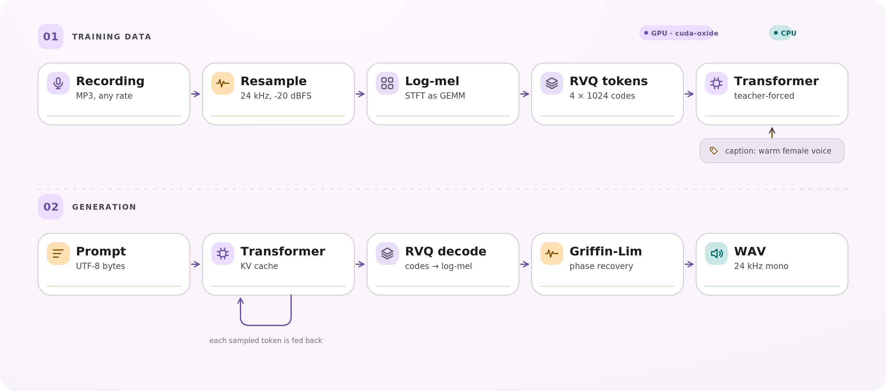
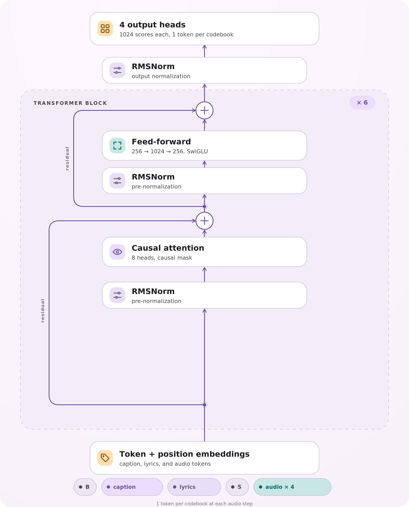
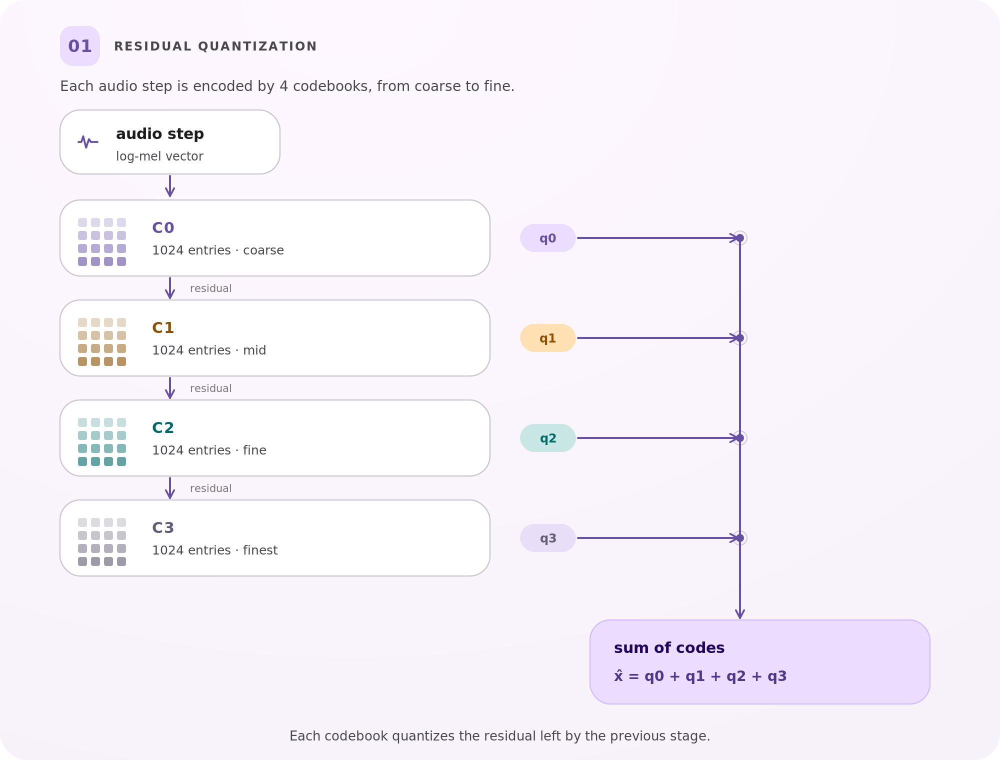

<p align="center">
  
</p>

<h1 align="center">StaleyNET</h1>

<p align="center">
  A Rust implementation of text-prompted music generation for NVIDIA edge GPUs.
</p>

<p align="center">
  <a href="https://crates.io/crates/staleynet-audio"></a>&nbsp;
  <a href="LICENSE"></a>&nbsp;
  <a href="docs/assets/paper-preprint.pdf"></a>&nbsp;
  <a href="#book-and-paper"></a>&nbsp;
  <a href="https://huggingface.co/arpanpathak/staleynet-checkpoints"></a>
</p>

<p align="center">
  <a href="docs/assets/cover.svg">
    
  </a>
</p>

StaleyNET maps a text caption to a waveform. The pipeline is written in Rust. Its GPU kernels use
[cuda-oxide](https://github.com/NVlabs/cuda-oxide) on Jetson devices. The design,
experiments, and limitations are documented in the book under `book/`.

## How it works

<p align="center">
  
</p>

The upper row builds the training cache: audio is resampled to 24 kHz, converted
to log-mel, encoded into residual vector quantization codes, and packed with the
caption bytes. The lower row generates: a prompt is read as UTF-8 bytes, the
Transformer samples code tokens step by step with a KV cache, and
Griffin-Lim reconstructs the waveform.

## Inside the model

<p align="center">
  
</p>

The block is pre-normalized. Residual path 1 carries the input around attention, and path 2 carries the attention output around the feed-forward network.

## Audio tokens

<p align="center">
  
</p>

4 codebooks of 1024 entries encode each audio step, from coarse to fine.

### Delay pattern

Codebooks are offset so the model predicts a staircase of tokens rather than a flat sequence.

### GPU tiling

Each thread block owns an output tile and reads the rows and columns it needs.

### KV cache

Generation keeps 1 query row per step and reuses the keys and values already computed.

## Quick start

```bash
cargo oxide build -- --release

staleynet prepare  --song-describer data/raw/song-describer --cache data/cache
staleynet tokenize --cache data/cache
staleynet train    --cache data/cache --run runs/base --config configs/base.json
staleynet sing     --cache data/cache --run runs/base --prompt "upbeat pop with female vocals" --out song.wav
```

Train on your own recordings with `--folder <dir>`: each audio file may have a
same-named `.txt` holding 1 description per line and a `.lyrics.txt` holding
the words sung. The studio's Record tab writes this layout to
`data/recordings/`.

### Lyrics

A model with `"lyrics_bytes": 256` in its configuration reads the words to sing
alongside the caption. It learns them from songs whose lyrics are known, such as
[JamendoLyrics](https://github.com/f90/jamendolyrics) (78 CC-licensed songs,
time-aligned line by line) and your own takes, and can be warm-started from a
model without lyrics:

```bash
staleynet prepare  --jamendo-lyrics data/raw/jamendolyrics --cache data/cache-jamendolyrics
staleynet tokenize --cache data/cache-jamendolyrics --reuse data/cache/tokenizer.json
staleynet train    --run runs/lyrics --config configs/lyrics-orin.json --fine-tune-from runs/vocal-scratch/best
staleynet evaluate --run runs/lyrics
staleynet sing     --run runs/lyrics --prompt "grunge rock, raw male voice" --lyrics-file song.txt --out song.wav
```

Training writes `latest/` (weights, AdamW moments and step) every
`checkpoint_every` steps; `--resume` continues from it without losing the
optimiser state, and `--steps N` extends a finished run.

## Book and paper

The book covers the method, the measurements, and the limitations. It is built
with mdBook from `book/src/SUMMARY.md`:

```bash
mdbook serve book
```

The paper has 2 builds: a 1-column
[preprint](docs/assets/paper-preprint.pdf) and a 2-column
[IEEE version](docs/assets/paper-ieee.pdf). The LaTeX sources are under
[`paper/`](paper/README.md). The figures in both are drawn from the same TikZ
sources in [`paper/figures/`](paper/figures).

## Checkpoints and data

The trained checkpoints and the derived training caches are kept in 2 private
Hugging Face repositories:

- [staleynet-checkpoints](https://huggingface.co/arpanpathak/staleynet-checkpoints):
  `best/` weights, `latest/` weights with AdamW moments, configs, metrics, and
  training logs.
- [staleynet-data](https://huggingface.co/datasets/arpanpathak/staleynet-data):
  SDD and JamendoLyrics caches, the fitted tokenizer, generated samples, and the
  author's own takes.

`artifacts/README.md` records the layout, the pinned
revisions, and the checksums. The raw third-party audio is not redistributed;
the dataset cards describe how to obtain it.

## Name

StaleyNET is named for Layne Staley (1967 to 2002), singer of Alice in Chains.
The emblem is a chain link enclosing the model's view of music: 4 rows of
tokens, 1 per residual codebook from coarse (bone) to fine (rust), shifted
into the staircase of the delay pattern. On the animated cover the columns
light up in sequence, as the model generates step by step. Both are
drawn by code:

```bash
python3 book/tools/emblem.py book/src/figures/emblem.svg
python3 book/tools/cover.py  book/src/figures/cover.svg
```

The Rust logo is the [official artwork](https://github.com/rust-lang/rust-artwork)
of the Rust Foundation, licensed
[CC BY 4.0](https://creativecommons.org/licenses/by/4.0/) and modified here
(rust colours and texture). Its use follows the
[Rust trademark policy](https://rustfoundation.org/policy/rust-trademark-policy/)
and does not imply endorsement by the Rust project.

## Layout

| Crate | Responsibility |
|---|---|
| `staleynet-audio` | Decoding, polyphase resampling, STFT / log-mel, Griffin-Lim (CPU reference) |
| `staleynet-cuda` | cuda-oxide kernels, `Tensor`, shape-checked GPU operations, CPU references |
| `staleynet-model` | Transformer with hand-derived backward pass, AdamW, KV-cached decoding, sampling, checkpoints |
| `staleynet-data` | Dataset catalogues, GPU log-mel, residual k-means tokenizer, batch sampling |
| `staleynet-train` | Training loop, validation, metrics, checkpoint policy |
| `staleynet-cli` | The `staleynet` command |

## Verification

```bash
cargo test --release -p staleynet-audio
cargo oxide test -- --release -p staleynet-cuda    # kernels against CPU references
cargo oxide test -- --release -p staleynet-model   # finite differences, KV cache, memorisation, checkpoints
cargo oxide test -- --release -p staleynet-data    # GPU log-mel against rustfft, tokenizer, batch layout
```

## Data and licences

Code is Apache-2.0. The default training data is the
[Song Describer Dataset](https://zenodo.org/records/10072001): Jamendo
recordings with human-written captions. The captions are CC BY-SA 4.0; each
recording carries the licence listed in its metadata. Lyrics data comes from
[JamendoLyrics MultiLang](https://github.com/f90/jamendolyrics) (Durand,
Stoller and Ewert, 2023), whose songs and lyrics carry the licence listed per
song in `JamendoLyrics.csv`.

Paper and book text are CC BY 4.0. Checkpoints and derived caches are CC BY-SA
4.0 to the extent the upstream dataset licences allow. The author's own
recordings are not licensed for reuse. See [`NOTICE`](NOTICE) for the full
provenance statement.

## Studio (listen in the browser)

`studio/` is a separate, dependency-light web app (plain `cargo`, no GPU code)
that calls `staleynet sing` and plays the results with live spectrograms.

It also has a Record tab: sing (with or without guitar), type the lyrics and
a description, listen back, and save the take to `data/recordings/` as
training data. Browsers only allow the microphone on `https://` pages or on
`localhost`, so serve it over HTTPS with a self-signed certificate and accept
the browser's warning once:

```bash
cd studio && ./make-certificate.sh
cargo run --release -- --address 0.0.0.0:8765 --tls-cert certs/studio.crt --tls-key certs/studio.key
# open https://<jetson-ip>:8765
deploy/thor/pull-run.sh thor-base   # refresh the Thor checkpoint while it trains
```

## Visual assets

`docs/assets/` holds the cover, emblem, badge chips, and the 3 exported diagrams used by this README.
The cover and emblem come from `book/src/figures/`; the pipeline, model, and
RVQ diagrams are drawn for this page. They carry the same CC BY 4.0 licence
as the book and paper.
