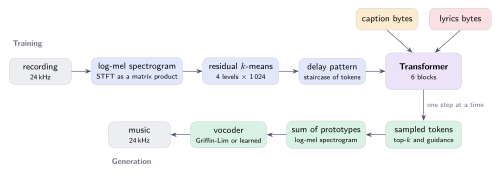

# System Overview

This chapter describes the system as a whole before the following chapters
examine its parts. It covers what the system does during training and during
generation, the probability model it learns, and the way the code is
organized.

## Training and generation

During training, the system reads recordings together with their text
descriptions (captions) and, where available, the words that are sung
(lyrics). The text is kept as a plain sequence of bytes. The audio is turned
into a sequence of tokens by the tokenizer of the previous chapters. A
Transformer network then learns to predict each audio token from the text and
from all the audio tokens that come before it. This is the same learning
problem as predicting the next word of a sentence, applied to sound.

During generation, the trained network receives only the text. It produces
the audio tokens one step at a time, each time feeding its own choice back in
as context for the next. The finished token sequence is decoded into a
spectrogram, and the spectrogram is converted into a waveform.

## The probability model

The network learns a probability distribution over audio given text. To state
it precisely, let \\(x\\) be the text and let the audio be a sequence of
\\(T\\) steps, \\(a_1, a_2, \dots, a_T\\). Each step consists of the \\(C = 4\\)
numbers chosen by the tokenizer's four rounds, written
\\(a_t^0, a_t^1, a_t^2, a_t^3\\), from coarse to fine. The network models the
probability of a whole piece as a product of single predictions:

\\[
p(\text{audio} \mid x) \;=\; \prod_{t=1}^{T} \prod_{c=0}^{3}
p\!\left(a_t^{c} \,\middle|\, x,\; a_1, \dots, a_{t-1}\right).
\\]

In words, the probability of a piece is the probability of its first step
given the text, times the probability of its second step given the text and
the first, and so on. Training adjusts the network to make the recorded
pieces as probable as possible. Generation follows the same product forward,
drawing each step from the network's predicted distribution.

The formula predicts the four numbers of a step together, each from the steps
before it. The finer numbers of a step would benefit from knowing the coarser
number of the same step, which this formula does not allow. The
[delay pattern](model.md#the-delay-pattern) recovers almost all of that
benefit with a small shift of the sequence.

## Organization of the code

The implementation is divided into seven Rust crates, arranged so that each
depends only on crates above it in the following table.

| Crate | Contents |
|---|---|
| `staleynet-audio` | Reading audio files, resampling, spectrogram analysis and the Griffin-Lim reconstruction, as plain CPU code that serves as the reference for the GPU versions. |
| `staleynet-cuda` | The GPU kernels written in Rust and compiled by cuda-oxide, the tensor type that holds GPU data, and CPU versions of each kernel for testing. |
| `staleynet-model` | The Transformer, its gradient computation, the optimizer, the incremental decoder used for generation, sampling, and checkpoint files. |
| `staleynet-data` | Dataset catalogs, GPU spectrogram extraction, the tokenizer and the assembly of training batches. |
| `staleynet-train` | The training loop, validation, logging and the checkpoint policy. |
| `staleynet-vocoder` | The neural vocoder: its network, the inverse STFT, the spectral losses with their gradients, and its own training loop. |
| `staleynet-cli` | The `staleynet` command-line program that ties the crates together. |

A separate program, `studio/`, serves a web page for generating and listening
to samples and for recording new singing as training data.

## Decisions that shape the implementation

Several decisions recur throughout the code, and each has a specific reason.

The GPU code is built from a small number of operations, the most important
being one general matrix product. Spectrogram analysis, the tokenizer's
nearest-prototype search and every layer of the Transformer are expressed
through it. Concentrating the arithmetic in one kernel means that one set of
tests covers most of the numerical work, and that one optimization, such as
the register-blocked kernel described in [GPU Implementation](gpu.md), speeds
up the whole system.

Each GPU array records its own dimensions, and the functions that launch GPU
kernels check those dimensions first. A GPU kernel that receives an array of
the wrong size does not fail; it silently reads or writes the wrong memory.
Checking sizes on the CPU side turns such mistakes into immediate, readable
errors.

The memory needed for a training step is allocated once, before training
begins, and reused for every step. Allocating GPU memory is slow and can
fragment the limited memory of an embedded device, and reusing buffers avoids
both problems.

All randomness is drawn from seeded generators, and the one place where GPU
threads would normally add into the same memory location in an unpredictable
order (the gradient of the embedding table) is computed in a fixed order
instead. As a result, a training run repeated on the same device produces
exactly the same numbers, which makes differences between experiments
attributable to the change being tested.

Finally, the trainer regularly saves not only the network's weights but also
the internal state of the optimizer. If a run is interrupted, it can continue
exactly where it stopped instead of restarting its learning-rate schedule and
losing the optimizer's accumulated statistics.
