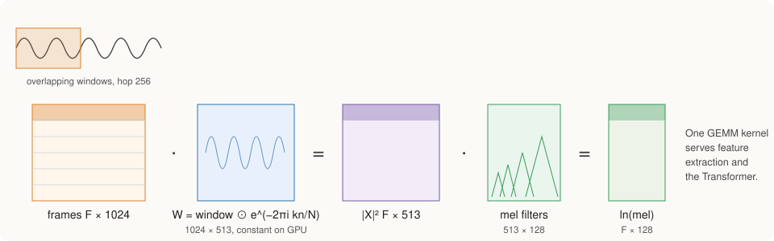

# Audio Representation

A model that generates music has to work with some description of sound. The
most direct description, the waveform, lists the air pressure 24 000 times per
second. Much of that detail is the exact phase of each vibration, which the
ear barely notices, so a model trained on waveforms would spend most of its
capacity on information that listeners do not hear. StaleyNET therefore
describes sound with a **log-mel spectrogram**, a picture of how much energy
is present in each frequency band during each short moment of time. This
chapter explains how a recording becomes such a spectrogram and how a
spectrogram is turned back into a waveform after generation.

## From a recording to a clean signal

The training recordings arrive in different formats (MP3, FLAC, AAC, Ogg
Vorbis and WAV), at different sample rates, and often in stereo. Before any
analysis, every audio file in the dataset is decoded into a sequence of
floating-point samples, and its stereo channels, where present, are averaged
into a single mono channel.

The decoded audio is then resampled to a common rate of 24 000 samples per
second, so that one second of music always corresponds to the same number of
analysis frames. Resampling is a filtering problem: when the rate is reduced,
any content above half the new rate (12 kHz here) must be removed first, or it
folds back into the audible range as distortion, an effect known as aliasing.
The resampler in `staleynet-audio/src/resample.rs` uses a windowed-sinc
low-pass filter, following Julius O. Smith's treatment of bandlimited
interpolation at CCRMA. For a conversion between two fixed rates, such as
44.1 kHz to 24 kHz, the filter only ever needs to be evaluated at a small
number of fractional positions (80 in this case), so its coefficients are
computed once and each output sample is a single weighted sum. A unit test
confirms the filter's purpose: a 15 kHz tone, which lies above the new 12 kHz
limit, is suppressed by more than 80 dB when 48 kHz audio is converted to
24 kHz.

Finally, the loudness of each recording is normalized to the same average
level (an RMS of −20 dBFS). Commercial and amateur recordings differ widely
in volume, and without this step the model would have to learn those
differences as part of the music.

## Measuring energy over time and frequency

A spectrogram is built by cutting the signal into short overlapping frames
and measuring the strength of each frequency within each frame. The choices
below fix how fine the picture is in time and in frequency.

| Setting | Value | What it means |
|---|---|---|
| Frame length | 1 024 samples (42.7 ms), Hann window | Long enough to separate notes about 23 Hz apart; the window tapers the frame edges to avoid spurious frequencies. |
| Frame spacing (hop) | 256 samples | A new frame every 10.7 ms, about 94 frames per second, with each frame overlapping the next by three quarters. |
| Frequency bands | 128 mel bands from 0 to 12 kHz | Bands are narrow at low frequencies and wide at high ones, matching the ear's resolution (the mel scale, as defined by Slaney). |
| Compression | natural logarithm, with a floor of 10⁻⁵ | Loudness is perceived roughly logarithmically; the floor keeps silence finite. |

The 128 bands are more than speech systems usually use (80 to 100), because
music contains harmonic detail across a wider range than speech. The result is
that one second of audio becomes a grid of about 94 frames by 128 bands, a far
more compact description than 24 000 samples.

## Computing the spectrogram on the GPU

The usual way to measure the frequencies in a frame is the fast Fourier
transform (FFT). A Fourier transform can also be written as an ordinary matrix
multiplication: each frequency is a fixed pattern of sines and cosines, and
multiplying a frame by the matrix that holds these patterns measures how
strongly each pattern is present. Written this way, the analysis of a whole
recording becomes one large matrix product,

\\[
X = F \, W,
\\]

where each row of \\(F\\) is one frame of the recording (1 024 samples), each
column of \\(W\\) is the windowed sine or cosine pattern of one frequency, and
each row of the result \\(X\\) is the spectrum of one frame. A second matrix
product then pools the 513 frequencies of each spectrum into the 128 mel
bands.

The matrix form performs more arithmetic than an FFT, roughly 1 024 operations
per frequency instead of about ten. It was nevertheless chosen because the GPU
code for matrix products is the same code that runs the Transformer, which is
tested thoroughly, so the spectrogram inherits that verification instead of
requiring a second numerical kernel. In practice the cost is acceptable: on
the Orin NX the GPU analyzes 60 seconds of audio in 47 ms, against 73 ms for a
multithreaded CPU FFT. A test compares the GPU spectrogram with an
FFT-based reference and finds them within 0.01 log units in every audible
band.

## Turning a spectrogram back into sound

After generation, the model's output has to be heard, which means converting
a spectrogram back into a waveform. This is harder than the forward direction,
because the spectrogram records only how strong each frequency is, not the
phase that says where in its cycle each vibration starts. The missing phase
has to be estimated.

StaleyNET estimates it with the Griffin-Lim algorithm in its accelerated form
(Griffin and Lim, 1984; Perraudin, Balazs and Søndergaard, 2013). The idea is
to search for a waveform whose spectrogram matches the target. Starting from
random phase, the algorithm converts the current estimate to a waveform and
back, keeps the target strengths together with the newly obtained phase, and
repeats. Each round makes the phase more consistent with the strengths, and
64 rounds are used. Before the search begins, the 128 mel bands are expanded
back to the 513 linear frequencies with a regularized least-squares inverse
of the pooling step.

Griffin-Lim needs no training, but its estimated phase leaves a characteristic
metallic, slightly smeared quality. How much this matters, compared with the
other losses in the pipeline, is measured in
[Experiments](experiments.md#5-the-audio-pipeline-in-isolation).

## Why Griffin-Lim smears voices

A sustained harmonic, such as a sung vowel, needs a phase that advances
smoothly from one frame to the next at the harmonic's own frequency. Griffin-Lim
never hears real audio; it only makes neighboring frames agree with each other.
Its phases therefore drift, and where frames overlap they partly cancel,
which the ear hears as a metallic, phasey smear. Voices suffer most, because
their pitch and the vowels that make words recognizable live in exactly these
harmonics, and sharp onsets such as drum hits spread into a faint pre-echo.

The cost is measurable. Even on a perfect spectrogram, Griffin-Lim adds an
average error of 0.19 log units per band, and the audible damage is larger
than that number suggests, because the measure compares magnitudes only and
cannot see the phase errors that cause the smear. This is why the generated
voices sound blurred even when the model predicts the right tokens.

The remedy is a **neural vocoder**: a network that learns, from real
recordings, how to turn a spectrogram into a waveform, phase included (Kong et
al., 2020; Siuzdak, 2023). StaleyNET's vocoder is being built on the design of
Vocos. For every frame it predicts the magnitude and the phase of each
frequency from the mel spectrogram, and an inverse Fourier transform turns
these into sound. It is trained on spectrograms decoded from StaleyNET's own
tokens, with the original recordings as targets, so that it learns not only
the phase but also part of the detail that the tokens lose.
