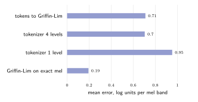
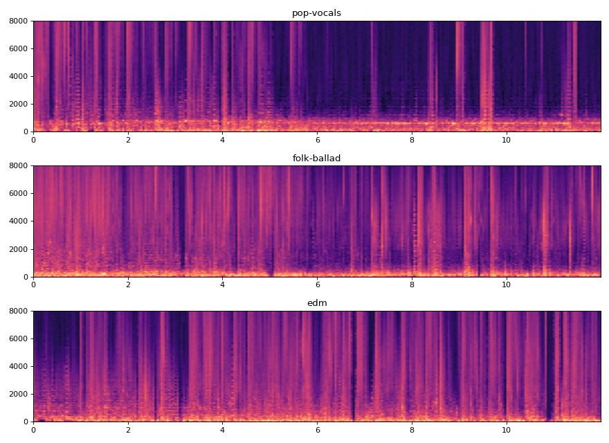

# Experiments

## Experimental setup

**Hardware.** Two devices were used, often concurrently with other
workloads:

* NVIDIA Jetson Orin NX 16 GB (Super developer kit), CUDA 12.6;
* NVIDIA Jetson AGX Thor, on which other GPU services shared the device and
  left about 4 GB of memory for training.

Unless stated otherwise, figures were measured on the Orin NX.

**Data.** The Song Describer Dataset and JamendoLyrics MultiLang, partitioned
by artist as described in [Training](training.md#data-and-partitions).

**Metrics.** Losses are mean cross-entropies in nats per code (chance level
6.93). Spectral errors are mean absolute differences of natural-log mel
energies; one unit is a factor of e in energy, about 4.3 dB. Throughput is given in
sequence positions per second.

**Procedures.** Every number in this chapter is produced by a command listed
in [Reproducibility](reproducing.md). Raw results are stored in
`benchmarks/`, `runs/*/metrics.jsonl`, `samples/reconstruction/report.json` and
`runs/*/lyrics-evaluation-*.json`.

## 1. Correctness

| Test suite | Scope | Result |
|---|---|---|
| `staleynet-cuda` (9 tests) | Every kernel against a CPU reference; the GEMM in all transpose, batch and accumulation modes, for all three implementations, on ragged sizes | pass |
| `staleynet-model` (12 tests) | Gradients against central finite differences for every parameter tensor; cached decoding against the full forward pass (≤ 10⁻⁴), with and without a lyrics field; memorisation of a fixed batch; exact checkpoint round trip including optimiser moments; warm start into a model with lyrics; sequence layout and lyrics windowing | pass |
| `staleynet-data` (10 tests) | GPU log-mel against the rustfft reference (≤ 10⁻² on audible bins); monotone RVQ error; next-position targets; lyrics cropping and even spreading of untimed lines; weighted sampling | pass |
| `staleynet-audio` (7 tests) | STFT/iSTFT round trip ≤ 10⁻⁴; resampler accuracy in band and > 80 dB anti-aliasing; Griffin-Lim preserves the log-mel | pass |

## 2. GPU kernels

Matrix products at the shapes used by the model (a batch of 4 × 512
positions); each figure is the mean of five runs after one warm-up run.

| Product | Shape (M × N × K) | Naive GFLOP/s | Tiled GFLOP/s | Speed-up |
|---|---|---|---|---|
| QKV projection | 2048 × 768 × 256 | 32.2 | 263.4 | 8.2× |
| Feed-forward expansion | 2048 × 1024 × 256 | 42.0 | 264.2 | 6.3× |
| Codebook heads | 2048 × 4096 × 256 | 30.5 | 217.4 | 7.1× |
| STFT as GEMM | 4096 × 513 × 1024 | 38.6 | 224.0 | 5.8× |

A forward and backward training step on 4 × 512 positions takes 2 919 ms with
the naive kernel and 537 ms with the tiled kernel, a speed-up of 5.4×.

**Register blocking.** On the AGX Thor, replacing the tiled kernel with the
register-blocked kernel reduced the time of a training step on 4 × 768
positions from 238 ms to 147 ms (1.62×), raising throughput from 12 900 to
20 800 positions per second. Both figures were measured during training runs
with identical shapes, while other services shared the GPU. Isolated
measurements of the three kernels are reported by `staleynet bench`.

**Feature extraction.** The log-mel spectrogram of 60 s of audio takes 78 ms
on the GPU and 98 ms with the multithreaded rustfft reference on the Orin's
eight Cortex-A78AE cores. The \\(O(N^2)\\) cost of the DFT-as-GEMM formulation
consumes most of the GPU's advantage on this device.

## 3. Key/value caching

Sampling 200 audio frames (203 delayed steps) with a randomly initialised
default-size model:

| Attention | ms per step |
|---|---|
| Recomputation of the full context | 23.42 |
| Key/value cache | 3.19 |

The cache is 7.3 times faster at this context length, and the gap grows
linearly with the context.

## 4. The tokenizer

The tokenizer was trained on 3.69 million steps from the 667 training tracks
(subsampled to 200 000 vectors) with 20 Lloyd iterations per level. Mean
absolute log-mel error, averaged over tracks, after decoding with the first
*n* codebooks:

| Codebooks used | 1 | 2 | 3 | 4 |
|---|---|---|---|---|
| Training (667 tracks) | 1.040 | 0.906 | 0.828 | 0.771 |
| Validation (39 tracks, unseen artists) | 1.044 | 0.911 | 0.833 | 0.776 |
| JamendoLyrics validation, reused codebooks | 1.089 | 0.959 | 0.879 | 0.821 |

The validation error lies within 0.7 % of the training error, so the
codebooks generalise to unseen artists, and they transfer to the lyrics corpus
with a modest increase. The absolute error is nevertheless large: 0.77
natural-log units correspond to about 6.7 dB per mel band, and each additional
level removes less error than the previous one (−0.13, −0.08, −0.06).

## 5. The audio pipeline in isolation

Listening to generated samples suggested pitched, melodic content with a
blurred and unintelligible voice. Two experiments were designed to locate the
source of the blur without involving the generative behaviour of the model.

### Reconstruction without a model

`staleynet reconstruct` takes 12-second excerpts of held-out vocal tracks and
renders them through the pipeline in stages: the exact log-mel through
Griffin-Lim, the tokens decoded with one codebook, and the tokens decoded with
all four codebooks. The last rendering is the best output that any language
model trained on these tokens could produce. Errors are measured against the
exact log-mel of the excerpt.

| Excerpt (validation) | Griffin-Lim on exact mel | Tokenizer, 1 codebook | Tokenizer, 4 codebooks | Tokens through Griffin-Lim |
|---|---|---|---|---|
| sdd-1014963 (guitar, brass, female voice) | 0.230 | 1.055 | 0.807 | 0.821 |
| sdd-103089 (folk metal, male voice) | 0.152 | 0.973 | 0.707 | 0.703 |
| sdd-1116696 (electronic, vocal sample) | 0.170 | 0.801 | 0.569 | 0.554 |
| sdd-1245191 (bass, piano, wordless vocals) | 0.222 | 0.984 | 0.732 | 0.763 |
| **Mean** | **0.194** | **0.953** | **0.704** | **0.710** |

The tokenizer introduces between three and four times the spectral error of
Griffin-Lim, and the end-to-end error of a perfect language model is almost
entirely that of the tokenizer. An error of 0.7 units, about 3 dB per mel
band on average, is consistent with the blurred quality heard in generated
voices, which depend on fine spectral detail (harmonics and formants). The
measure does not capture the phase artefacts of Griffin-Lim, which are audible
in the second rendering although its spectral error is small; the comparison
therefore establishes the tokenizer as the dominant *spectral* limitation,
not as the only audible one. The renderings are in `samples/reconstruction/`.

### Memorisation of a single excerpt

To test the language model independently of data scarcity, a fresh
default-size model was trained on a single 12-second excerpt (sdd-103089,
562 frames) with its caption, using batch 4, peak learning rate
10⁻³ and no weight decay (`configs/overfit-one-take.json`).

| Step | Training loss (nats per code) |
|---|---|
| 50 | 2.493 |
| 100 | 0.054 |
| 150 | 0.008 |
| 200 | 0.002 |

The model was then asked to generate 12 seconds from the caption without
guidance, and the sampled codes were compared with the excerpt's codes:

| Decoding | Agreement per codebook | Identical frames from the start |
|---|---|---|
| Greedy | 1.000, 1.000, 1.000, 1.000 | 562 of 562 |
| Top-k 250, seed 1 | 0.996, 1.000, 1.000, 0.996 | 26 |
| Top-k 250, seed 2 | 1.000, 0.998, 0.993, 0.998 | 26 |

Greedy free-running generation reproduces the excerpt token for token, and
top-k sampling departs from it only at isolated tokens without accumulating
error. The architecture, the delay pattern, the key/value-cached decoder and
the sampler are therefore capable of reproducing audio exactly, and a model
that has learned an excerpt produces precisely the tokenizer reconstruction
measured above. Together, the two experiments indicate that improving the
audio representation is a precondition for intelligible singing: further
training of the language model on the present tokens cannot exceed the
fidelity of the reconstruction. The renderings are in `samples/overfit/`.

## 6. Training

### Initial run (Orin NX)

`configs/smoke.json`: the default 7.1-million-parameter model, batch 8 × 512
positions, 1 500 steps (about 6.1 million positions, or 1.7 passes over the
3.69 million training steps), warm-up of 100 steps and cosine decay. Wall-clock
time was 25 minutes at 4 100 positions per second. Validation loss on the 39
held-out tracks:

| Step | Mean | Codebook 0 | Codebook 1 | Codebook 2 | Codebook 3 |
|---|---|---|---|---|---|
| 250 | 5.93 | 4.68 | 6.32 | 6.42 | 6.30 |
| 500 | 5.44 | 3.55 | 5.75 | 6.26 | 6.20 |
| 750 | 5.21 | 3.33 | 5.30 | 6.11 | 6.10 |
| 1 000 | 5.06 | 3.22 | 5.04 | 5.97 | 6.01 |
| 1 250 | 4.98 | 3.15 | 4.90 | 5.88 | 5.96 |
| 1 500 | **4.93** | 3.12 | 4.84 | 5.84 | 5.94 |

The validation loss decreased at every evaluation and remained close to the
training loss, indicating that the run ended under-fitted. Codebook 0 is the
most predictable (3.1 nats, a perplexity of about 23 of 1 024); the finest
codebooks are the least predictable (about 5.9 nats), since they encode
residual detail that is close to noise.

### Extended run (AGX Thor)

`configs/thor.json` (batch 4 × 768, planned for 30 000 steps) ran at 12 900
positions per second, 3.3 times the throughput of the Orin NX, and was stopped
at step 15 625 to free the device for the subsequent experiments. The best
validation loss on the 39 held-out tracks was **4.02 nats at step 15 000**,
against 4.93 for the initial run; with the model and data unchanged, the
improvement is attributable to tenfold longer training.

### Vocal subset: fine-tuning against training from scratch

Two runs were trained on the vocal subset (281 training and 19 validation
tracks):

| Run | Device | Initialisation | Schedule | Best validation | At step |
|---|---|---|---|---|---|
| `vocal-finetune` | Thor | extended run | 8 000 steps, peak learning rate 3 × 10⁻⁴ | **4.23** | 250 |
| `vocal-scratch` | Orin NX | random | 6 000 steps, batch 8 × 512, peak 6 × 10⁻⁴ | 4.72 | 5 500 |

These losses are measured on the vocal validation subset and are not
comparable with the 4.02 of the extended run, which was measured on all 39
validation tracks.

Initialisation from the extended run is worth about 0.5 nats per code. The
fine-tuned model reached its best validation loss after only 250 steps;
thereafter its validation loss rose to about 4.30 and remained there while its
training loss continued to fall, which indicates that 281 tracks do not
support prolonged fine-tuning at this learning rate. The model trained from
scratch improved until near its final step and ended with a training loss of
3.53 against a validation loss of 4.72, a gap that likewise points to
insufficient data. On informal listening, samples from `vocal-scratch` were
perceived as blurred but melodic voices; this is a single listener's
impression rather than a controlled evaluation.

## 7. Lyrics conditioning

Models with a 256-byte lyrics field were warm-started from the two vocal
models and trained on a mixture of the vocal subset, JamendoLyrics and, after
the first 750 (Orin) and 4 750 (Thor) steps, the rock subset with weight 3.
The use of the lyrics was measured with the paired protocol of
[Lyrics Conditioning](lyrics.md#evaluation-protocol) on 48 batches of four
crops.

**First runs.** With JamendoLyrics at weight 2 (73 training songs against 281
vocal-subset tracks), about one third of training sequences were drawn from
the lyrics corpus. The Thor run (8 000 steps, warm-started from
`vocal-finetune`) gave the following losses at its best checkpoint (step
4 750):

| Split | Aligned | Removed | Mismatched | Mismatched − aligned |
|---|---|---|---|---|
| JamendoLyrics validation (6 songs) | 4.2962 | 4.3031 | 4.2964 | +0.0002 |
| JamendoLyrics training (73 songs) | 3.9728 | 3.9779 | 3.9776 | +0.0048 |

The difference between mismatched and aligned lyrics is negligible on held-out
songs and very small on training songs. The model responds weakly to the
presence of text (the removed condition is slightly worse) but not to its
content: it has not learned to use the lyrics. The likely causes are the small
share of lyric-bearing sequences, the short schedule, and the difficulty of
learning a text-to-audio alignment from 78 songs in four languages.

**Second run.** A Thor run of 20 000 steps with JamendoLyrics at weight 8 and
the register-blocked GEMM (`configs/lyrics-thor-long.json`) overfitted
quickly: its training loss fell to 2.66 while its held-out loss stayed near
4.34, and its best held-out checkpoint is that of step 250. The paired test on
that checkpoint, now reported with the standard error of the paired
difference, gave:

| Songs | Correct | None | Other song | Other minus correct |
|---|---|---|---|---|
| JamendoLyrics held-out (6) | 4.3345 | 4.3409 | 4.3345 | +0.0000 ± 0.0004 |
| JamendoLyrics training (73) | 4.0337 | 4.0395 | 4.0378 | +0.0042 ± 0.0006 |

On held-out songs the correct and the wrong lyrics give the same loss, so the
model does not use the words. On training songs the difference is
statistically clear but small, which points to memorisation of those songs
rather than a general relation between words and sound. In both cases the
model scores slightly worse with no lyrics than with any lyrics: it reacts to
the presence of text, not to its content.

## 8. Generation

Three prompts of 12 seconds each, generated from the initial checkpoint with
top-k 250, temperature 1.0, guidance scale 3 and seed 1 on the Orin NX:

| Prompt | Sampling | Griffin-Lim | Real-time factor |
|---|---|---|---|
| upbeat pop song with female vocals and electric guitar | 3.3 s | 1.0 s | 0.36 |
| slow acoustic folk ballad with a male singer and fingerpicked guitar | 3.4 s | 1.0 s | 0.37 |
| energetic electronic dance music with a heavy kick drum | 3.4 s | 1.1 s | 0.37 |

Generation runs about three times faster than real time, including guidance,
which doubles the number of forward passes.

The spectrograms show rhythmic onsets and, for the pop prompt, sustained
harmonic lines between 300 and 600 Hz. The prompt influences the output: the
share of energy below 250 Hz is 0.57 for the pop prompt, 0.88 for folk and
0.90 for dance. Broadband clicks, visible as vertical stripes, are present in
all three samples; in the light of Section 5 they are attributed in part to
the tokenizer and Griffin-Lim, although the contribution of each factor has
not been isolated. No formal listening test has been conducted, so these
results do not establish perceived quality, musicality or intelligibility.
