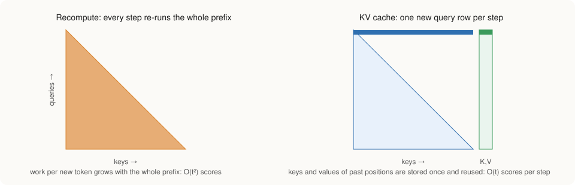

# Generation

To generate music, the trained network is given the text and asked to
continue the sequence. It predicts a probability for every possible value of
the next audio step, one value is drawn from that prediction, the drawn step
is appended to the sequence, and the process repeats until the requested
length is reached. This chapter describes how this loop is made fast, how the
values are drawn, how the output is pushed to follow the text more closely,
and how the result becomes sound.

## Reusing earlier work: the key/value cache

In attention, each new position compares itself with every earlier position
through two vectors that those positions computed, called keys and values.
These vectors do not change once computed, because a position never looks
forward. A naive generator would nonetheless recompute them for the whole
sequence at every step, which repeats the same work hundreds of times.

The generator therefore keeps the keys and values of all processed positions
in a cache, one per layer (Pope et al., 2023). Each new step computes only its
own query, key and value, appends its key and value to the cache, and attends
over the cache. The cache has a fixed capacity, and positions not yet filled
are excluded by the same mask that prevents looking ahead. Because the sizes of
all arrays stay constant, generation allocates no memory after it starts.

A test confirms that this shortcut changes nothing: it feeds a sequence to the
cached generator one position at a time and requires its predictions to match
those of the full network within \\(10^{-4}\\) at every position, for models
with and without lyrics.

When the cache is full, the generator rebuilds it from the text and the most
recent half of the audio, and continues. Pieces longer than the network's
context can be generated in this way, with the most recent audio always in
view.

## Drawing values: top-k sampling

Always choosing the single most probable value tends to produce repetitive,
lifeless output, while drawing from the full distribution occasionally picks
very unlikely values that sound like errors. Top-k sampling (Fan, Lewis and
Dauphin, 2018) takes a middle course: for each tokenizer round it keeps the
\\(k\\) most probable values (250 by default, as in MusicGen), discards the
rest, and draws among the survivors in proportion to their probabilities. A
temperature setting adjusts how strongly the draw favors the most probable
values; a temperature of zero always picks the most probable one.

## Following the text more closely: classifier-free guidance

Because 10 % of the training examples had their text removed, the same
network can predict audio both with and without the text. The difference
between the two predictions indicates what the text contributes.
Classifier-free guidance (Ho and Salimans, 2022) exaggerates that
contribution. At each step the generator runs two streams, one with the text
and one without, each with its own cache, and combines their scores as

\\[
\text{guided} = \text{without text} + s \times (\text{with text} - \text{without text}),
\\]

where the scores are the network's raw outputs before they are turned into
probabilities and \\(s\\) is the guidance scale. With \\(s = 1\\) the result is
the ordinary prediction with text; values above one, such as the default of
3, push the output further in the direction the text indicates. The cost is
twice the computation per step and somewhat less variety between samples.

## From numbers to sound

When all steps have been generated, the delay pattern is undone so that the
four numbers of each step are back together. Each step is decoded by adding up
its four prototypes, the standardization applied before tokenization is
reversed, and the resulting spectrogram is converted into a waveform with 64
rounds of Griffin-Lim. `staleynet sing` writes the waveform and a short report
of the time spent in each stage, including the real-time factor: the time
taken divided by the duration of the audio produced, so that a value below one
means faster than real time.
