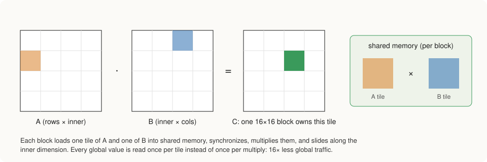

# GPU Implementation

All of StaleyNET's numerical work runs on the GPU, and all of its GPU code is
written in Rust. This is made possible by cuda-oxide, an experimental compiler
backend from NVIDIA that translates Rust functions marked `#[kernel]` into PTX,
the GPU's instruction format. Host code (running on the CPU) and kernels
(running on the GPU) live in the same crate, and cuda-oxide generates a typed
Rust function for launching each kernel. The roughly twenty kernels of the
project live in `crates/staleynet-cuda/src/kernels/`, one file per topic: matrix
products, attention, the loss, the optimizer, element-wise operations,
normalization, embeddings, and signal processing. A kernel that needs more than
a few numbers receives them as one small structure, such as `Product` for a
matrix product or `AdamWStep` for one optimizer step, so that each value
arrives with its name and its documentation. This chapter
explains how the kernels divide their work among GPU threads, describes the
matrix product in detail, and explains how the code is kept safe and correct.

## How kernels divide their work

A GPU runs thousands of threads at once, grouped into blocks, and a kernel
decides which part of the problem each thread handles. StaleyNET's kernels
follow four patterns.

In the simplest pattern, used for operations such as adding two arrays, each
thread computes one element of the output. The last block usually has more
threads than elements remain; cuda-oxide's `DisjointSlice` type returns no
element for such surplus threads, so they cannot write outside the array.

Operations that need a whole row of a matrix at once, such as normalization,
the softmax inside attention and the cross-entropy, assign one warp (a group
of 32 threads that execute together) to each row. The 32 threads each take
every 32nd element of the row and then combine their partial sums or maxima by
exchanging values directly between threads, without going through memory.

Matrix products assign one block of threads to each rectangular tile of the
output, as described below. Finally, the sums of squares needed to measure the
size of all gradients use a fixed number of blocks that sweep over the data,
each producing a partial sum that the CPU adds up.

## The matrix product

The matrix product is by far the most important kernel: the spectrogram, the
tokenizer's distances, every projection in the network and both products
inside attention go through it. A single kernel handles all of these cases. It
computes, for a batch of matrix pairs,

\\[
C \leftarrow \alpha \cdot A \cdot B \quad (\text{optionally } + \; C),
\\]

where either input can be read as stored or as transposed. The kernel does not
need a separate flag for this: each input is described by the distance in
memory between neighboring rows and between neighboring columns (its
strides), and a transposed matrix is the same memory read with the two
distances exchanged. The batch allows the attention of all heads and all
sequences to be computed in one launch, and reading an input transposed avoids
creating transposed copies in memory.

Three versions of this kernel exist, and comparing them shows where the time
goes. The **naive** version gives each output element its own thread, which
reads a full row of \\(A\\) and a full column of \\(B\\) from the GPU's main memory.
Main memory is slow compared with the arithmetic units, and every value is
read many times by different threads, so this version spends most of its time
waiting for data.

The **tiled** version lets a block of 16 × 16 threads cooperate. The block
copies a 16 × 16 tile of each input into shared memory, a small, fast memory
that the threads of a block share, and computes with the tiles before moving
on to the next pair. Each value is now fetched from main memory once per block
instead of once per thread, sixteen times less traffic. On the Orin NX this
raises throughput from about 35 to about 250 billion operations per second.

The **register-blocked** version (Volkov and Demmel, 2008) goes one step
further. Shared memory is fast, but reading it still costs time, and in the
tiled version each multiplication needs two shared-memory reads. In the
register-blocked version each thread computes a 4 × 4 group of outputs instead
of one. It reads four values of each input and combines them in all sixteen
pairings, keeping the running sums in its registers, the fastest storage on
the chip. Four times as much arithmetic is done for each value read. The
threads are also arranged so that neighboring threads read neighboring
memory words, which lets the hardware serve a whole group of threads in one
access. On the AGX Thor this version reduced the time of a training step from
238 ms to 147 ms, and it is now the default.

## Making the embedding gradient repeatable

During the backward pass, the gradient of the embedding table is obtained by
adding the gradient at every position into the table row of the token found
there. Many positions share a token, so many additions target the same row.
The usual GPU solution is atomic addition, which lets threads add into the same
location safely but in an unpredictable order. Because floating-point
addition is not exactly associative, the result then differs slightly from run
to run.

StaleyNET avoids this by first building, on the CPU, an index that lists for
every token the positions where it occurs (a counting sort, stored in
compressed sparse row form). One GPU thread per token and column then adds up
exactly those positions, always in the same order. The result is identical on
every run, which keeps experiments repeatable.

## Safety

Launching a kernel is inherently risky: if the launch dimensions do not match
what the kernel expects, threads read or write memory they should not, and
nothing reports the error. cuda-oxide therefore marks such launches `unsafe`
in Rust's sense, meaning the programmer must guarantee their validity. In
StaleyNET every launch is wrapped in a small, safe function in
`staleynet-cuda/src/ops/`. The function first checks each size the kernel
depends on and only then launches it, with a comment stating why the launch is
valid. Inside the kernels, writes go through two small helpers in
`kernels/device.rs` that check the index against the length of the output
before writing, so the kernels themselves contain no unchecked memory access. The model and
its layers call only the safe wrappers.

## Testing the kernels

The file `crates/staleynet-cuda/tests/kernels_match_reference.rs` runs every
kernel on random data and compares the result with a straightforward CPU
implementation of the same formula. The test sizes are chosen to be awkward,
for example 17 × 33 × 9 and 5 × 129 × 31, so that tiles and warps are only
partly filled, which is where indexing errors usually hide. The matrix product
is tested in every combination of transposed inputs, with and without batching
and accumulation, for all three versions. Results must agree within a
relative difference of \\(10^{-5}\\), or \\(10^{-4}\\) for reductions whose
additions happen in a different order.

## Practical notes

Several details of cuda-oxide may help others using it on Jetson devices. The
`libm::sqrtf` function does not compile for the GPU on ARM hosts because its
implementation is written in inline assembly, whereas `f32::sqrt` works. A
CUDA context belongs to one CPU thread at a time, so multi-threaded test
runners must attach it in each test (`Gpu::bind_to_current_thread`). A crate's
tests are run through the backend with `cargo oxide test -- -p <crate>`.
The project follows cuda-oxide's main branch, and the revision it was last
tested with is recorded in `Cargo.lock` (see the README).
