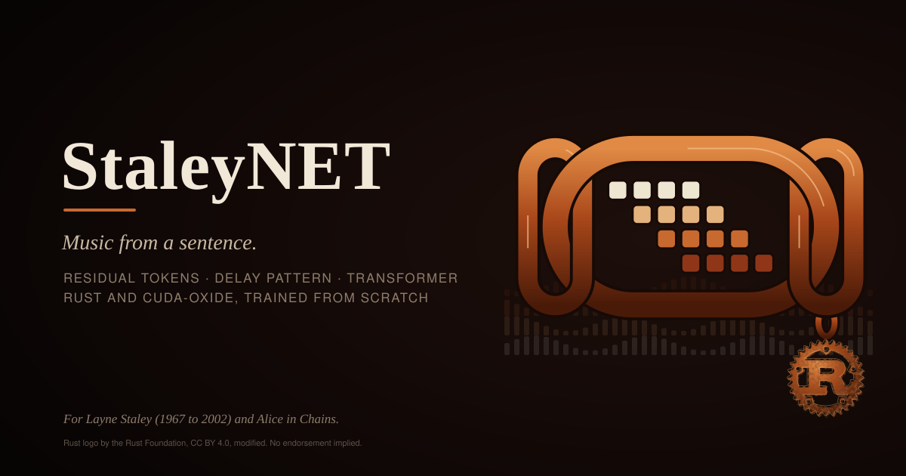

# Introduction

*StaleyNET is named in memory of Layne Staley (1967 to 2002), vocalist of
Alice in Chains.*

## Abstract

StaleyNET is a text-conditioned generative model of music audio, built and
trained entirely from random initialization on two embedded NVIDIA Jetson
devices. Every stage is implemented in Rust: feature extraction, a residual
vector quantizer, a decoder-only Transformer with a hand-derived backward
pass, the training loop and the sampler. All numerical kernels are compiled
to GPU code with cuda-oxide, an experimental Rust-to-PTX compiler. No
pretrained network, codec, vocoder or text encoder is used.

Sound is described by its log-mel spectrogram, and every 21 milliseconds of
spectrogram is reduced to four whole numbers, each chosen from a list of 1 024
prototypes learned by k-means clustering. A Transformer of about seven million
parameters learns to predict these numbers one after another, in the way a
text model predicts words, given a text description of the music and, in an
extended variant, the lyrics to be sung. The
model is trained on the Song Describer Dataset (23 hours of Creative Commons
music with human-written captions) and, for lyrics, on JamendoLyrics
MultiLang (4.7 hours with line-level alignment).

The report documents the method, the verification of every kernel and of the
full gradient, the performance of the GPU implementation, and the training
results. It also decomposes the error of the audio pipeline. This analysis
attributes the limited fidelity of the generated audio mainly to the
tokenizer rather than to the language model or the vocoder. Finally, it
describes a protocol for testing whether a model actually uses its lyrics,
together with the results obtained so far.

## Motivation

Recent text-to-music systems, such as MusicLM and MusicGen, combine
large pretrained components: a neural audio codec, a text encoder and a
language model of hundreds of millions to billions of parameters, trained on
tens of thousands of hours of audio with datacenter accelerators. Their
results are impressive, but the pretrained components conceal much of what
the system has to learn, and the computational requirements place the
complete pipeline out of reach of most individual researchers.

This project takes the opposite position. Each component is built from first
principles, trained from scratch on public data, and made small enough to
train on an edge device. The aim is not to match the quality of large systems
but to make every part of the pipeline inspectable and measurable, and to
identify which part limits the result.

## Research questions

1. Can a small decoder-only Transformer over discrete log-mel tokens learn
   text-conditioned musical structure from roughly 23 hours of captioned
   audio?
2. What limits the fidelity of the generated audio, and how much of the
   limitation is attributable to the language model as opposed to the audio
   representation and the vocoder?
3. Can such a model learn to use lyrics when trained on a small corpus with
   line-level alignment, and how can this be tested objectively?
4. What do shared-memory tiling, register blocking, key/value caching and the
   delay pattern contribute to training and inference cost on an edge GPU?

## Contributions

* A complete text-to-audio pipeline in Rust whose GPU kernels are written in
  Rust and compiled with cuda-oxide, including a strided, batched GEMM in
  three implementations and fused kernels for normalization, attention and
  cross-entropy.
* A testing approach in which each GPU kernel is checked against a CPU
  reference and the gradients of the whole network against numerical
  estimates.
* A lyrics-conditioning scheme that extends a trained model with a lyrics
  field without discarding what it has learned, and a paired evaluation
  protocol that measures whether the field is used.
* A decomposition of the reconstruction error of the audio pipeline into
  tokenizer and vocoder contributions.
* Measurements on two devices, the Jetson Orin NX 16 GB and the Jetson AGX
  Thor, with the commands needed to reproduce each of them.

## How the results were verified

A system written from scratch has no established library to vouch for its
arithmetic, so its correctness has to be demonstrated. Two kinds of test carry
most of that weight. The GPU kernels are compared, one by one, with simple CPU
implementations of the same formulas, on deliberately awkward matrix sizes
where indexing mistakes tend to appear. The hand-written gradients of the
whole network are compared with gradients estimated numerically, by nudging
each parameter and observing how the error changes.

The figures in this report come from the project's own commands, which are
listed in [Reproducibility](reproducing.md): `staleynet bench` for speed,
`staleynet train` for training curves, and `staleynet reconstruct` and
`staleynet evaluate` for the analyses of the audio pipeline and of the lyrics.
Where a statement rests on listening rather than on measurement, the text says
so. The known weaknesses of the system are collected in
[Limitations](limitations.md).

## Organization

[Related Work](related-work.md) places the project among existing systems.
The method chapters then follow the data through the pipeline: the [system overview](architecture.md),
the [audio representation](audio.md), [tokenization](tokenizer.md), the
[model](model.md), [lyrics conditioning](lyrics.md), [training](training.md)
and [generation](generation.md). [GPU Implementation](gpu.md) describes the
kernels. The evaluation part reports the [experiments](experiments.md), the
[reproduction procedure](reproducing.md) and the
[limitations](limitations.md).

The figures are animated SVG and play in any modern browser without scripts.
