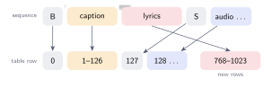

# Lyrics Conditioning

A caption such as *"slow grunge song with a raw male voice"* tells the model
what a piece should sound like, but not which words should be sung. To let a
user supply the words, the model needs a second text input for lyrics, and it
needs training examples in which it can observe which words are sung during
which stretch of audio. This chapter describes how the lyrics enter the
sequence, how an existing model is extended to read them, how training
examples are paired with the right lines, how long lyrics are handled during
generation, and how one can test whether a trained model actually uses them.

## Where the lyrics go in the sequence

The lyrics occupy 256 additional byte positions between the caption and the
`SEPARATOR` mark. A sequence of a model with lyrics therefore has this layout:

```text
part           BEGIN  caption (126 bytes)   lyrics (256 bytes)    SEPARATOR  audio …
position       0      1 to 126              127 to 382            383        384 …
position row   0      1 to 126              768 to 1023           127        128 …
```



The last line needs explanation. The network learns one position vector for
each row of a position table, and the vector added at a position is taken from
the row shown. The caption, the separator and the audio use exactly the rows
they used before lyrics were introduced. The lyrics use 256 new rows placed
after the 768 that already existed.

## Extending a model that was trained without lyrics

The reason for this arrangement is that it lets an already trained model
acquire a lyrics input without losing what it has learned. If the lyrics had
been inserted using the existing rows, every audio position would have moved
to a different row, and the model's knowledge of where it is in a piece would
no longer apply. With the arrangement above, extending a model amounts to
appending 256 new, randomly initialized rows to its position table. All other
parameters keep their trained values, and training only has to teach the
model what the new positions mean.

The function `checkpoint::load_weights` performs this extension when a new
run is started from an older checkpoint: it copies every parameter by name
and, where the new model's table is longer, copies the old rows into its
beginning. Two tests guard the scheme. One checks that the copied parameters
are identical to the originals; the other confirms that generation with the
incremental decoder gives the same predictions as the full network for a
model with lyrics, which would fail if the position rows were mapped
inconsistently.

## Pairing audio with the words sung in it

Each training example covers a window of about 13.6 seconds taken from a
song. For the model to learn which sounds correspond to which words, the
lyrics given with that window must be the lines actually sung during it. Two
sources provide this information in different ways.

JamendoLyrics MultiLang (Durand, Stoller and Ewert, 2023) is a set of 78
Creative Commons songs in English, French, German and Spanish, created for
research on aligning lyrics with audio. For every line of lyrics it records
the time at which the line starts and ends. A training window is given every
line whose time span overlaps it.

Recordings made with the StaleyNET studio come with the text that was sung but
without timings. For these, the lines are assumed to be spread evenly over the
recording: in a 20-second take of four lines, the second line is taken to
occupy seconds 5 to 10. This assumption is reasonable for short takes of
continuous singing, which is what the recording page asks the singer to
provide.

As with captions, the lyrics are occasionally removed during training (in 10 %
of examples, together with the caption). This teaches the model to generate
without any text as well, which the guidance technique described in
[Generation](generation.md) requires.

## Mixing small and large datasets

The lyrics corpus is much smaller than the caption corpus (4.7 hours against
23 hours). If training examples were drawn from all songs with equal
probability, examples with lyrics would be rare and the model would have
little opportunity to learn from them. Each dataset is therefore given a
weight: a dataset with weight 8, for example, makes each of its songs eight
times as likely to be drawn as a song of the main corpus. The weights used in
each experiment are reported with its results.

## Generating with long lyrics

A song's lyrics are usually far longer than the 256 bytes that the model reads
at once. During generation the lyrics are therefore divided into consecutive
windows, each holding as many complete lines as fit, and the requested length
of audio is divided equally among them. When the generator reaches the end of
one window's share, it replaces the lyrics in its input with the next window,
keeps the most recent audio as context, and continues, so the voice carries on
into the next lines instead of starting again.

## Testing whether the model uses the lyrics

A model's training loss can improve on the lyrics corpus without the model
reading the lyrics at all, because it can simply learn what the songs in that
corpus sound like. Whether the words influence the predictions has to be
tested directly. The test, run by `staleynet evaluate`, takes the same
windows of held-out songs and scores the model's predictions three times:

1. with the correct lyrics for each window;
2. with no lyrics;
3. with lyrics taken from a different song (always a sung passage, so that
   this input is never empty).

Because all three runs use exactly the same audio windows, the scores can be
compared window by window, which removes most of the variation between
windows. If the model ignores the lyrics, the three scores are equal. If it
uses them, the correct lyrics should help it predict the audio, and the
mismatched lyrics should not, so the error with mismatched lyrics should be
higher. The reported quantity is the average of that difference,

\\[
\Delta = \text{average over batches of } \bigl(\text{error with mismatched lyrics} - \text{error with correct lyrics}\bigr),
\\]

measured in nats per predicted number, together with its standard error. The
model is said to use the lyrics only when \\(\Delta\\) is larger than twice its
standard error, so that a difference produced by chance is not mistaken for an
effect. Comparing the second and third runs adds a finer distinction: a model
that reacts to the presence of any text, but not to which words it is given,
scores the same with correct and with mismatched lyrics.
