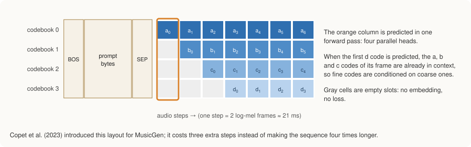
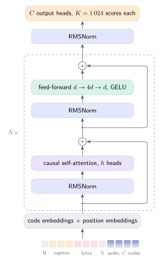

# The Model

The network at the center of StaleyNET is a Transformer of the kind used for
language models such as GPT-2 (Radford et al., 2019). It reads one long
sequence that begins with the text and continues with the audio, and at every
position it predicts what comes next. This chapter describes how text and
audio share that sequence, how the four numbers of each audio step are
arranged, what happens inside the network, and how its gradients are
computed.

## Putting text and audio in one sequence

A Transformer reads a sequence of symbols, each drawn from one shared
vocabulary. StaleyNET's vocabulary combines three kinds of symbol. The first
256 entries are the possible values of a byte, so any text can be written
directly as its UTF-8 bytes without a separate text tokenizer (a choice also
studied for text models by Xue et al., 2022). Three further entries mark the
structure of the sequence: `BEGIN` opens it, `SEPARATOR` ends the text, and
`PADDING` fills unused text positions. The remaining 4 096 entries are the
audio numbers: 1 024 for each of the tokenizer's four rounds.

The text part of the sequence always has the same length, 128 positions: the
`BEGIN` mark, 126 bytes of caption, and the `SEPARATOR`. Shorter captions are
filled with `PADDING` and longer ones are cut. Keeping the length fixed means
that the first audio step always appears at the same position, which
simplifies both training and generation.

```text
BEGIN  b₀ b₁ … b₁₂₅  SEPARATOR  audio step 1  audio step 2  …
```

Each audio position carries all four numbers of one step. The network's
input at such a position is the sum of the learned vectors (embeddings) of
the four numbers, plus a learned vector for the position itself, which tells
the network where in the sequence it is. Text positions use the same scheme
with a single byte. [Lyrics Conditioning](lyrics.md) describes how a second
text field for lyrics is added to this layout.

## The delay pattern

At every position the network makes four predictions at once, one for each
tokenizer round. This creates a problem. The finer rounds are corrections to
the coarse one; to predict a correction well, the network should already know
which coarse prototype it is correcting. If all four numbers of a step were
predicted at the same position, the network would have to guess the coarse
number and its corrections simultaneously.



MusicGen (Copet et al., 2023) solves this by shifting each round by one more
position than the previous one. The coarse number of step \\(t\\) is predicted
at one position, the first correction of step \\(t\\) one position later, the
second correction two positions later, and the finest one three positions
later. By the time a correction is predicted, the coarse number it refines is
already part of the input. The cost is only three extra positions per
sequence, whereas placing the four rounds in four separate positions would
make every sequence four times as long.

## Inside the network




The network is a stack of six identical blocks. Each block lets every
position gather information from the earlier positions (attention) and then
transforms each position on its own (a small feed-forward network). Each of
the two parts adds its result to its input rather than replacing it, which
makes deep networks much easier to train, and each part first rescales its
input to a standard size (RMS normalization; Zhang and Sennrich, 2019).
Written compactly, a block computes

\\[
h = x + \mathrm{Attention}(\mathrm{Norm}(x)), \qquad
y = h + \mathrm{FeedForward}(\mathrm{Norm}(h)),
\\]

where \\(x\\) is the sequence entering the block and \\(y\\) the sequence leaving
it. Attention is causal: a position may only look at itself and at earlier
positions, since during generation the later positions do not exist yet.

| Part | Size |
|---|---|
| Width of the vector at each position | 256 numbers |
| Attention | 8 heads, each looking at 32 of the 256 numbers |
| Feed-forward network | 256 → 1 024 → 256, with the GELU activation |
| Output | four predictions per position, each over 1 024 possibilities |

The network has 7.1 million adjustable parameters. Almost a third of them sit
in two places: the table of input embeddings (1.1 million) and the four
output layers that score the 1 024 possibilities of each round (1.05
million).

Before training, the parameters are set to small random values, drawn with a
standard deviation of 0.02 as in GPT-2. The two layers in each block that add
their output into the running sum are scaled down further, by
\\(1/\sqrt{12}\\) for six blocks, so that the sum does not grow larger with
every block it passes through.

## Computing gradients by hand

Training requires, for every parameter, the gradient: how much the error
would change if the parameter changed slightly. Machine-learning frameworks
derive gradients automatically. No such framework exists for Rust on the GPU,
so every layer of StaleyNET implements its gradient explicitly, derived on
paper and documented next to the code.

Attention illustrates what this involves. In the forward direction, the
network compares each position's query \\(Q\\) with the keys \\(K\\) of earlier
positions, turns the comparison scores into weights \\(P\\) that sum to one,
and uses the weights to average the values \\(V\\):

\\[
P = \mathrm{softmax}\!\left(\frac{QK^\top}{\sqrt{d}} + M\right), \qquad O = PV,
\\]

where \\(d = 32\\) is the width of one head and \\(M\\) blocks later positions.
Given the gradient of the error with respect to the output \\(O\\), written
\\(\partial O\\), the chain rule yields the gradients of the inputs:

\\[
\partial V = P^\top \partial O, \qquad
\partial P = \partial O\, V^\top, \qquad
\partial S = P \odot \bigl(\partial P - \mathrm{rowsum}(\partial P \odot P)\bigr),
\\]

\\[
\partial Q = \tfrac{1}{\sqrt{d}}\, \partial S\, K, \qquad
\partial K = \tfrac{1}{\sqrt{d}}\, \partial S^\top Q,
\\]

where \\(\partial S\\) is the gradient with respect to the scores before the
softmax and \\(\odot\\) denotes element-wise multiplication. Each line is a
matrix product, so the gradient runs on the same GPU kernel as everything
else.

Hand-written gradients are easy to get subtly wrong, so they are checked
numerically. The test in `crates/staleynet-model/tests/model_is_trainable.rs`
nudges individual parameters up and down by a small amount, measures how the
error actually changes, and requires the result to agree with the
hand-computed gradient within 5 %. The test covers every parameter tensor of
the network.
