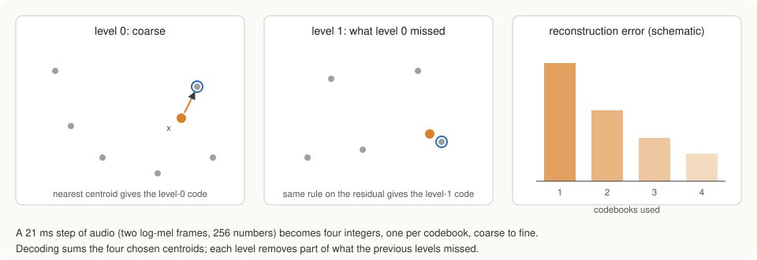
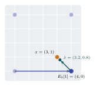

# Audio Tokenization

A language model predicts the next item in a sequence by choosing from a
fixed list of possibilities, its vocabulary, in the same way that a text
model chooses the next word. A spectrogram, however, consists of real
numbers, which can take infinitely many values. Before a language model can
learn from audio, each moment of the spectrogram has to be replaced by a
choice from a finite list. This replacement is called tokenization, and the
component that performs it is the tokenizer.

Large music systems use a pretrained neural codec for this purpose (for
example SoundStream, EnCodec or DAC). This project builds every component from
scratch, so it uses a simpler tokenizer that can be trained in minutes:
k-means clustering applied in several rounds, known as residual vector
quantisation.

## What is being tokenized

The spectrogram frames from the previous chapter are first standardised, band
by band, using the average and spread of each band over the training set, so
that loud and quiet bands contribute equally to the distances computed below.
Two consecutive frames are then joined into one unit, called a **step**. A
step covers 21.3 ms of audio and is a list of 256 numbers (2 frames × 128
bands). A two-minute recording becomes about 5 600 steps.

## The idea: describe each step by its nearest prototype

Suppose that a collection of 1 024 typical steps, called prototypes or
centroids, has been found. Any new step can then be described by naming the
prototype that most resembles it, which turns 256 real numbers into one whole
number between 0 and 1 023. The prototypes are found with Lloyd's k-means
algorithm (Lloyd, 1982): starting from 1 024 randomly chosen training steps,
it assigns every training step to its nearest prototype, moves each prototype
to the average of the steps assigned to it, and repeats these two moves twenty
times, by which point the prototypes barely change.

One list of 1 024 prototypes captures only the broad shape of a step. The
error that remains, the difference between the step and its prototype, still
contains useful detail. Residual quantisation therefore repeats the
procedure on these differences: a second list of 1 024 prototypes is trained
on the errors left by the first, a third on the errors left by the second, and
a fourth on those left by the third.

Written out, with \\(x\\) the step to be encoded, \\(r_\ell\\) the part of it that
remains to be described before round \\(\ell\\), and \\(e_\ell[k]\\) prototype
number \\(k\\) of round \\(\ell\\):

\\[
r_0 = x, \qquad c_\ell = \arg\min_k \lVert r_\ell - e_\ell[k] \rVert^2, \qquad
r_{\ell+1} = r_\ell - e_\ell[c_\ell].
\\]

Each round chooses the prototype \\(c_\ell\\) closest to what remains and
subtracts it.

A small example in two dimensions makes the procedure concrete. Suppose the
first codebook holds the 4 prototypes (0, 0), (4, 0), (0, 4) and (4, 4), the
second holds the 4 corrections (±0.8, ±0.8), and the point to encode is
x = (3, 1). The squared distances from x to the first codebook are 10, 2, 18
and 10, so round 1 chooses (4, 0) and leaves the remainder (−1, 1). The
correction closest to (−1, 1) is (−0.8, 0.8), so round 2 chooses it and leaves
only (−0.2, 0.2). The point is now described by 2 small integers, and its
reconstruction (3.2, 0.8) lies 0.28 from the original, against 1.41 after the
first round alone.

 Decoding reverses the process by adding up the four chosen
prototypes:

\\[
\hat{x} = e_0[c_0] + e_1[c_1] + e_2[c_2] + e_3[c_3].
\\]

Every step of audio is thus described by four whole numbers, ordered from the
coarse first choice to the finest correction. At 40 bits per 21.3 ms, this is
about 1.9 kilobits per second, a very compact description; the price of that
compactness is measured below. The coarse-to-fine order matters later,
because the model predicts the coarse number before the corrections that
depend on it (see [the delay pattern](model.md#the-delay-pattern)).

## Finding the nearest prototype quickly

Training and encoding repeatedly ask which of 1 024 prototypes is closest to a
step. Comparing each step with each prototype directly is slow, but the
squared distance can be rewritten as

\\[
\lVert x - e_k\rVert^2 = \lVert x\rVert^2 - 2\, x \cdot e_k + \lVert e_k\rVert^2 .
\\]

The first term is the same for every prototype and therefore does not affect
which one is closest. The second term, the dot product of the step with each
prototype, can be computed for 8 192 steps and all 1 024 prototypes at once as
a single matrix product on the GPU, and the third term is computed once per
prototype. A small GPU kernel then picks, for each step, the prototype with the
smallest total. The averaging that moves the prototypes is done on the CPU. A
prototype to which no step is assigned is restarted from a randomly chosen
training step, so that none of the 1 024 entries is wasted.

## One vocabulary for several datasets

The model can only learn from datasets that share its vocabulary. When a new
dataset is added after the tokenizer has been trained, such as the lyrics
corpus or newly recorded singing, it is encoded with the existing prototypes
(`staleynet tokenize --reuse`) rather than with newly trained ones. The
prototypes transfer well: on held-out songs of the lyrics corpus, which the
tokenizer never saw, the remaining error after four rounds is 0.821 log units,
compared with 0.776 on held-out songs of the original corpus.

## How much detail is lost

`staleynet tokenize` decodes every track again and reports the average
difference between the original and the decoded spectrogram after one, two,
three and four rounds. This number matters for the whole project, since no
model trained on these tokens can produce sound more faithful than the
tokenizer's own reconstruction. The measurements, and a comparison with the
losses of the other stages, are reported in
[Experiments](experiments.md#5-the-audio-pipeline-in-isolation).
