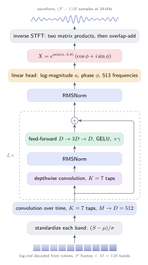

# The Neural Vocoder

A spectrogram says how strong each frequency is in each frame, but not where
in its cycle each vibration is: the phase. Turning a spectrogram back into
sound means supplying that phase. Griffin-Lim estimates it by making
neighboring frames agree with each other, and the result has the metallic
smear described in [Audio Representation](audio.md#why-griffin-lim-smears-voices).
A **neural vocoder** learns the phase instead, from real recordings. This
chapter describes StaleyNET's vocoder, how it is trained, and how its
gradients are computed by hand like everything else in the project.



## Staying at the frame rate

Early neural vocoders produced audio one sample at a time, and later ones
grew the frame rate to the sample rate through a stack of upsampling layers.
Both spend most of their computation at 24 000 steps per second. Vocos
(Siuzdak, 2023) takes a shorter route, and StaleyNET follows it. The network
runs at the frame rate, about 94 frames per second, and for each frame it
predicts what the spectrogram leaves out: the magnitude *and* the phase of
every one of the 513 frequencies. The last step, from a complex spectrum to
samples, is the inverse short-time Fourier transform, which is exact and
needs no learning.

This choice also fits the rest of StaleyNET. The analysis that turns audio
into a spectrogram is already written as a matrix product
([GPU Implementation](gpu.md)), and the inverse transform is the same product
read in the other direction.

## The network

The input is the log-mel spectrogram that the tokens decode to: one row of
128 band energies per frame. Each band is first standardized with the
tokenizer's own statistics, so that every band enters on a similar scale and a
spectrogram decoded from tokens looks like one computed from a recording.

A convolution over time then looks at each frame together with its three
neighbors on either side and lifts those 7 × 128 values to a vector of 512
numbers. On the GPU this is one matrix product: each frame's neighborhood is
copied into a row of 896 numbers, and the rows are multiplied by the weights.

Eight **ConvNeXt blocks** (Liu et al., 2022) follow. Each block does two
things in turn. A *depthwise* convolution filters each of the 512 channels over
time with its own seven taps, mixing neighboring frames but not channels. Then,
after RMS normalization, a small feed-forward network mixes the channels within
each frame: it expands the 512 numbers to 1 536, applies the GELU activation,
and projects back to 512. The result is scaled channel by channel and added to
the block's input:

\\[
h \leftarrow h + \gamma \odot \bigl(\operatorname{GELU}(\operatorname{Norm}(\operatorname{DW}(h))\,W_1 + b_1)\,W_2 + b_2\bigr).
\\]

The scales \\(\gamma\\) start at 1/8, so each block begins as a small correction
to what it receives; this keeps an eight-block stack easy to train.

A final normalization and a linear **head** turn each frame's 512 numbers into
1 026: a log-magnitude \\(a_k\\) and a phase \\(\phi_k\\) for each frequency
\\(k\\). The complex spectrum is

\\[
X_k = e^{\min(a_k,\ 4.6)}\,(\cos\phi_k + i\sin\phi_k).
\\]

Predicting the logarithm of the magnitude keeps loud and quiet frequencies on
the same footing, and the cap of \\(e^{4.6} \approx 100\\) stops an untrained
network from producing numbers that overflow. The phase needs no constraint:
the cosine and sine wrap it around the circle by themselves. The whole network
has 13.6 million parameters.

## From spectrum to samples

Each frame's spectrum becomes 1 024 samples through the inverse Fourier
transform of a real signal. Only the 513 non-negative frequencies are stored,
since the negative ones mirror them, so every frequency except the first and
the last counts twice. For all frames at once this is two matrix products,
one with the cosines and one with the sines, each of size
\\((F \times 513) \cdot (513 \times 1\,024)\\) for \\(F\\) frames, with the
synthesis window folded into the constant matrices.

**Overlap-add** then lays the frames down 256 samples apart, so that every
sample is covered by four frames, sums them, and divides each sample by the
sum of the squared window values that covered it. That division is what makes
analysis followed by synthesis return the original signal exactly.

## Learning from recordings

The vocoder is trained to make its waveform sound like the recording that the
spectrogram came from. Comparing waveforms sample by sample would punish a
correct sound with a slightly different phase, so the comparison is made on
spectra instead, at three resolutions:

| frames | hop | compared | weight | what it rewards |
|---|---|---|---|---|
| 1 024 samples | 256 | log-mel energies | 1 | errors weighted roughly as the ear hears them |
| 512 samples | 128 | log energies | 0.5 | sharp timing, since short frames see onsets clearly |
| 2 048 samples | 256 | log energies | 0.5 | fine frequency, since long frames separate close harmonics |

Each term is the mean absolute difference between the logarithms of the
estimate's and the recording's energies. Using several frame lengths keeps the
network from satisfying one view of the sound at the expense of another
(Yamamoto et al., 2020). Vocos also trains against learned discriminators,
networks that try to tell generated audio from real audio. StaleyNET starts
with the spectral terms alone, which are differentiable in closed form and
stable, and adds discriminators as a later stage.

### What it learns from

The language model produces tokens, so the vocoder trains on spectrograms
*decoded from tokens*, not on spectrograms of the recordings. The recording
supplies only the target waveform. The vocoder thus learns two things at once:
the phase that the spectrogram never stored, and part of the detail that the
tokenizer lost.

`staleynet vocoder prepare` stores every clip's samples beside its tokens,
resampled and level-normalized exactly as they were for analysis. A training
example is then a window of 64 consecutive frames decoded from a clip's tokens,
together with the samples those frames cover. Frame \\(f\\) is centered on
sample \\(256 f\\), so 64 frames cover \\(63 \cdot 256 + 1\,024 = 17\,152\\)
samples, about 0.71 seconds. A batch holds 16 windows from random clips of the
FMA rock corpus, 273 hours in all.

Training uses AdamW with \\(\beta_1 = 0.8\\) and \\(\beta_2 = 0.9\\), the values
Vocos uses, a learning rate that warms up to \\(5 \cdot 10^{-4}\\) over 1 000
steps and then follows a cosine down to \\(5 \cdot 10^{-5}\\) at 200 000 steps,
and gradients clipped to norm 1. Every step draws its windows from a random
generator seeded by the step number, so a run that stops and resumes sees the
same batches it would have seen without stopping. Checkpoints keep the
optimizer's moments for the same reason.

## Gradients by hand

As with the language model, there is no automatic differentiation; each stage
computes its own gradient. One observation saves most of the work. Cutting a
signal into overlapping frames and overlap-adding frames back into a signal
are *adjoint* linear maps: the gradient of one is the other. A single pair of
GPU kernels therefore serves four purposes: the inverse transform, its
gradient, the framing inside every loss, and that framing's gradient.

The other pieces are short. The gradient of an absolute difference is the sign
of the difference. The gradient of a logarithm with a floor is zero below the
floor. The gradient of \\(e^{a}(\cos\phi + i\sin\phi)\\) follows from the chain
rule, and a depthwise convolution's gradient with respect to its input is the
same convolution with the taps reversed.

A test checks the whole chain. It perturbs parameters of every kind, one at a
time, measures how the loss changes, and compares that with the computed
gradient. Because absolute differences have kinks, a single perturbation size
can mislead, so the test tries three sizes and requires agreement to within
5 % at one of them; a wrong derivation agrees at none.

## Using it

```bash
staleynet vocoder prepare --cache data/cache-fma-rock
staleynet vocoder train   --cache data/cache-fma-rock --run runs/vocoder-rock --config configs/vocoder-rock-thor.json
staleynet vocoder render  --cache data/cache-fma-rock --run runs/vocoder-rock --out samples/vocoder
staleynet sing --run runs/pq-large --vocoder runs/vocoder-rock --prompt "gritty rock vocal, distorted guitars"
```

A training run writes its metrics, a `best/` and a `latest/` checkpoint, and,
every 5 000 steps, the same held-out clips rendered through the vocoder, next
to the recordings and their Griffin-Lim rendering. In the studio, trained
vocoders appear in a picker beside Griffin-Lim.
